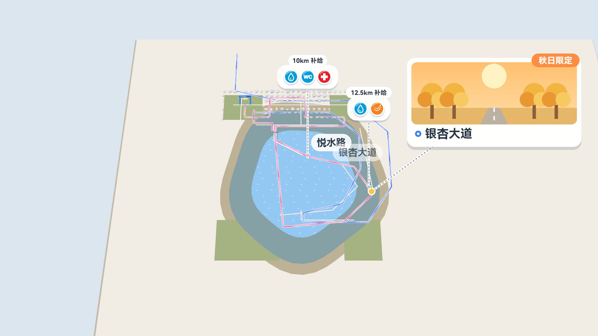
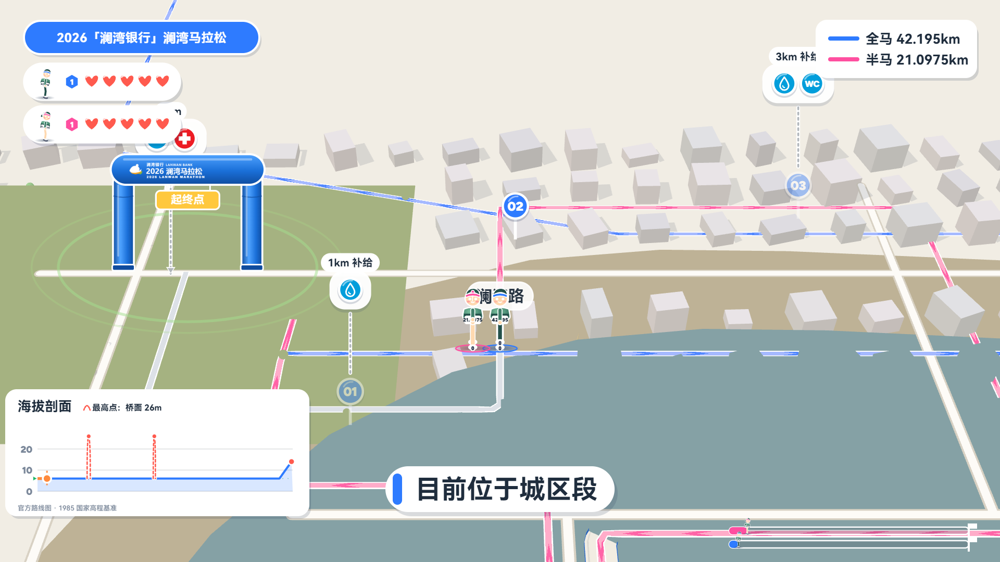
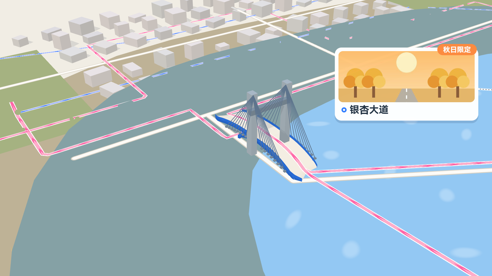
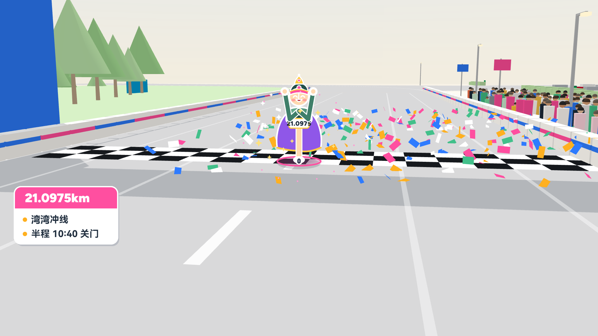

# CourseScrollWebView · 赛道长卷

> 把一条马拉松 / 越野 / 骑行赛道，做成两分钟的城市级介绍片：three.js 底图 + SVG 叠加层 + AI 位图角色，30 fps 逐帧确定性渲染。
> 本仓是**模板**：引擎通用，赛事内容全部外置在 `races/<赛事>/`。当前示例：`races/lanwan-2026`。
> 许可：MIT + Commons Clause —— 可自由使用、修改、商用，衍生作品无需开源；须保留版权与许可声明；**不得售卖软件/模板本身**。详见 [LICENSE](LICENSE)。

16:9 · 4K（3840×2160）· 30 fps · 当前成片 **123.04 s** · 三套画风（A 卡通 / B 导航地图 / C 剪纸）

## 效果

**赛道总览**



**赛段跑动**



**云澜大桥**



**半马冲线**



以上为 `races/lanwan-2026` 的 B 导航地图画风关键帧；A 卡通与 C 剪纸可 `npm run bible` 生成三册设定集查看。

## 快速开始

依赖：Node 24（依赖版本已锁定）、本机 Chrome、[`uv`](https://docs.astral.sh/uv/)（edge-tts / numpy / scipy），首次合成口播需要网络。

```bash
npm install
npm run bootstrap     # 抠图打包 → edge-tts 合成口播 → 音效 → 打包三套 stage
```

| 产物 | 说明 |
|---|---|
| `dist/stage-A-卡通.html`、`stage-B-导航地图.html`、`stage-C-剪纸.html` | 预览播放器（空格播放、←/→ 逐帧、Shift 跳 5 秒、右侧常显帧号） |
| `dist/成片-navi-4K.mp4` | 4K 成片，`npm run render4k` 生成 |
| `dist/分镜表.html`、`字幕表.html`、`设定集.html` | 文档页，`npm run docs` / `npm run bible` 生成 |

## 三步换赛事

1. 复制 `races/lanwan-2026/` 为 `races/<新 id>/`，改 `race.js`（赛事身份、吉祥物、地标）与 `config/*`。
2. `npm run race` 查看赛事包列表，`npm run race <新 id>` 切换（重写 `src/config/*` 的转发壳）。
3. `npm run preview` 重建三套预览；有官方路线数据时先跑 `npm run data`。

完整清单见 **[TEMPLATE.md](TEMPLATE.md)**。

## 常用命令

| 命令 | 作用 |
|---|---|
| `npm run race [id]` | 列出 / 切换赛事包 |
| `npm run bootstrap` | 首次全量构建（素材 + 口播 + 音效 + 预览） |
| `npm run preview` | 打包三套 stage |
| `npm run timeline` | 重新合成口播（强制） |
| `npm run sfx` | 合成音效床并混音 |
| `npm run render4k` | 渲染 4K 成片 |
| `npm run docs` | 分镜表 + 字幕表 |
| `npm run bible` | 三套设定集截图与页面 |
| `npm run voice` / `sfx:check` / `stems` | 口播、音效同步、分轨校验 |
| `npm run fonts` | 字体子集化（改字体后跑） |

## 改什么去哪里

配置都在赛事包里；`src/config/*.js` 只是转发壳，不要直接改。

| 想改的 | 文件 |
|---|---|
| 口播文案、分句 | `races/<id>/config/vo1031.js` 的 `CUE_LINES[].vo`（**时间轴不要动**） |
| 后补口播句 | `races/<id>/config/inserts.js` |
| 里程窗口、空档、停留段 | `races/<id>/config/schedule.js` |
| 镜头、信息卡、贴纸、事件、角色形态 | `races/<id>/config/story.js` |
| 配色与画风 token | `races/<id>/config/theme.js` |
| 路名标签 | `races/<id>/config/labels.js` |
| 关键帧时刻、环境图机位 | `races/<id>/config/keyframes.js` |
| 音效 cue / BGM | `races/<id>/config/sfx.js` / `bgm.js` |
| 赛事身份、吉祥物、地标 | `races/<id>/race.js` |
| 角色动效（bob / squash / tilt） | `src/art/sprites.js` |
| 图标、道具、贴纸 | `src/art/icons.js` / `props.js` / `stickers.js` |
| 渲染引擎（时间轴、三维底图、图层） | `src/engine/` |

## 目录

```
races/<id>        赛事包：config 全部可调参数、art 角色、landmarks 地标 SVG、source 原始稿
src/config        转发壳（export * → races/<ACTIVE_RACE>/config）
src/art           AI 位图角色引擎侧 + 纯 SVG 美术
src/engine        赛道查询 · 时间轴求值 · 三维底图 · 世界贴片 · HUD · 合成一帧
src/pages         stage 播放器/渲染目标 · bible 设定集 · index 总览 · dev 调试
tools             数据提取、AI 生图、抠图打包、TTS、音效合成、截图与校验
assets            角色原图/透明图/manifest、地标素材
data              赛道与地图派生数据（course / map_layers / world / venue_plan）
dist              打包产物（单文件 html 与 mp4，离线可开）
```

## 文档

| 文档 | 内容 |
|---|---|
| [TEMPLATE.md](TEMPLATE.md) | 模板结构、换赛事清单、每一层怎么改 |
| [docs/ART.md](docs/ART.md) | 三套画风、AI 角色与地标流程、图层与三维遮挡 |
| [docs/AUDIO.md](docs/AUDIO.md) | edge-tts 口播管线、音效、同步校验 |
| [docs/DATA.md](docs/DATA.md) | 赛道/地图数据来源与重新生成 |
| [docs/HISTORY.md](docs/HISTORY.md) | 逐批修改记录（排查历史行为用） |
| [docs/race-pack-checklist.md](docs/race-pack-checklist.md) | 新赛事包交付清单 |
| [docs/BGM-suno.md](docs/BGM-suno.md) | BGM 生成与规格 |
